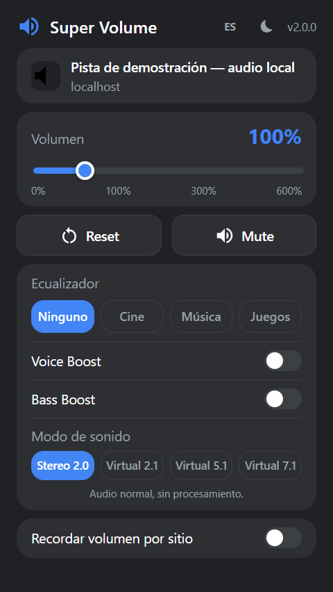
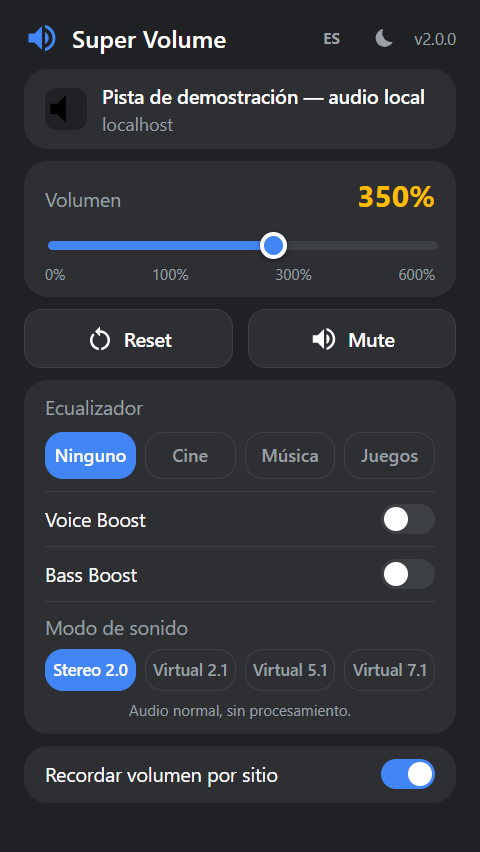
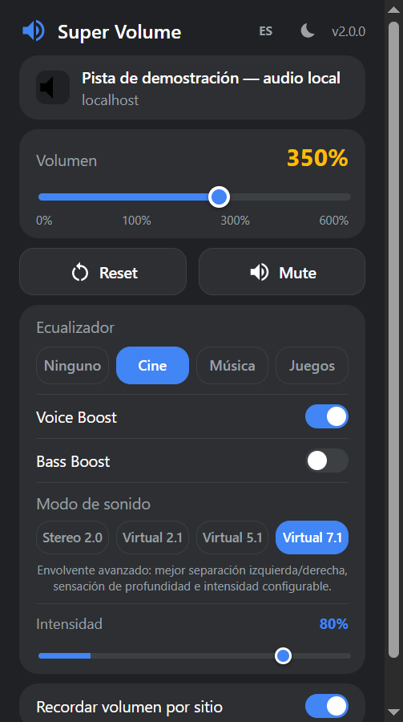

<p align="center">
  
</p>

<h1 align="center">Super Volume — Sitio web</h1>

<p align="center">
  Sitio web oficial de <b>Super Volume</b>, la extensión de Chrome que amplifica el audio de cualquier pestaña hasta 600%.
</p>

<p align="center">
  <a href="https://alvarosiles.github.io/webstore-super-volume-source/"><b>Ver el sitio</b></a> ·
  <a href="https://alvarosiles.github.io/webstore-super-volume-source/privacy.html">Política de privacidad</a> ·
  <a href="https://github.com/alvarosiles/super-volume">Código de la extensión</a>
</p>

---

## Sobre la extensión

Super Volume es una extensión para Google Chrome (Manifest V3) que procesa el
audio de la pestaña activa con la Web Audio API, sin modificar el volumen del
sistema y sin enviar datos a ningún servidor.

- Amplificación de volumen de **0% a 600%**
- **Ecualizador** de 3 bandas con presets Cine, Música y Juegos
- **Voice Boost** y **Bass Boost**
- **Sonido envolvente virtual**: 2.1, 5.1 y 7.1
- **Volumen recordado por sitio**
- Tema claro/oscuro y versiones en español e inglés

<p align="center">
  
  
  
</p>

## Contenido del repositorio

```
├── index.html                 # Página principal
├── privacy.html               # Política de privacidad
├── assets/
│   ├── icon32.png             # Favicon
│   ├── icon128.png            # Logotipo
│   └── capturas/              # Capturas del popup real (v2.0.0)
├── descargas/
│   └── super-volume-v2.0.0.zip  # Paquete de la extensión
├── LICENSE
└── README.md
```

Es un sitio estático: no tiene proceso de build, dependencias, cookies ni
herramientas de analítica. Solo carga fuentes de Google Fonts.

## Instalar la extensión

1. Descarga `super-volume-v2.0.0.zip` desde el sitio y descomprímelo.
2. Abre `chrome://extensions` y activa el **Modo de desarrollador**.
3. Pulsa **Cargar descomprimida** y selecciona la carpeta extraída.

## Derechos

© 2026 Alvaro Siles Estrada. **Todos los derechos reservados.**

El contenido de este sitio (código, diseño, textos e imágenes) no puede
copiarse ni reutilizarse sin autorización. El paquete de la extensión de
`descargas/` se distribuye bajo licencia MIT. Ver [LICENSE](LICENSE).

## Contacto

alvarosiles.developer@gmail.com · [github.com/alvarosiles](https://github.com/alvarosiles)
